<div align="center">

# Maison Orvelle

**A 3D boutique for women's tops: every piece turns live in WebGL, on a ring of plinths in a Parisian salon and on its own product stage, with colourways, fabric notes, a bag and a demo checkout.**


[Features](#features) · [Design](#design) · [Screenshots](#screenshots) · [Tech stack](#tech-stack) · [Getting started](#getting-started)

</div>

<br>

<p align="center">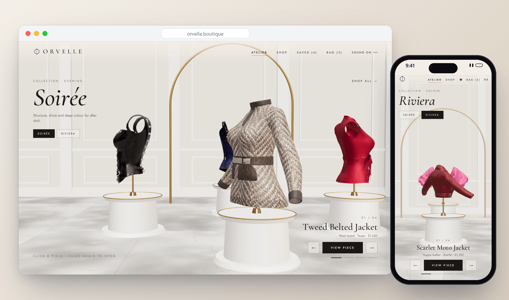</p>

## Overview

Maison Orvelle sells eight tops in two collections, **Soirée** (evening: tweed, satin, brocade and patent leather) and **Riviera** (colour: nappa leather, patchwork, taffeta and painted silk). Instead of product photos, every top is a real 3D model lit like a studio shoot.

- The home page is an **atelier**: the current collection stands on a ring of marble plinths under a brass arch, and the ring turns to bring each piece to the front.
- The **shop** shows every piece on its own small turntable, with search, filters and sorting.
- Each **product page** gives the piece a full stage: drag to turn it, tap gold dots for fabric notes and switch colourways, which re-dye the real fabric texture in a shader.
- A **bag**, a **saved pieces** list and a **demo checkout** complete the journey.

It is a front-end project. The catalogue is typed static data, and the bag and saved pieces live in `localStorage`, so it runs anywhere without a backend, keys or a database. All products and prices are fictional and in USD.

## Try the demo

```bash
npm install
npm run dev
```

Open http://localhost:3000. The ring turns by itself every few seconds; click a piece to bring it forward, click it again to open it. Switch to **Riviera** with the button under the collection title. On a phone, swipe left and right.

On a product page, drag the piece to turn it, tap a gold dot or a fabric chip for a note, pick a colourway and a size, then add it to the bag and go through the demo checkout. No payment details are asked for and no order is sent anywhere.

<p align="center">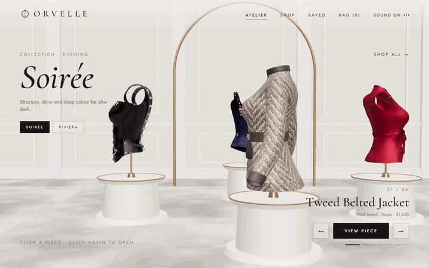</p>

## Features

### The atelier: a turning ring of pieces

The collection stands on a ring of stone plinths with brass rods, on a polished marble floor in front of a panelled salon wall. The front piece turns slowly on its own; the ring eases round when you pick another piece, and after the last piece the atelier moves on to the next collection. A warm light follows the mouse through the room, so satin and marble catch the glow. Opening a piece glides the camera up to it before an ivory veil falls and the product page loads.

<p align="center">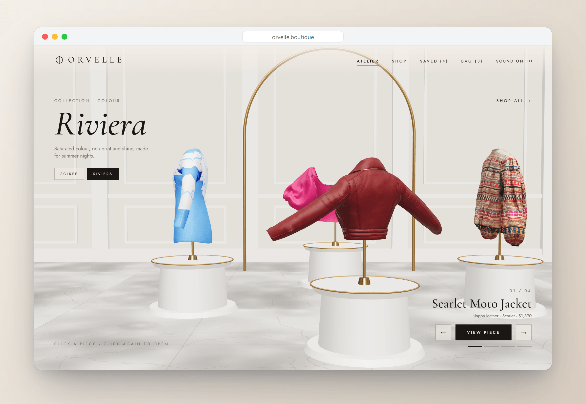</p>

### A shop where every card is a turntable

All eight pieces turn on their own stands against their own tint, and turn faster when you hover them. Search ignores accents ("soiree" finds Soirée) and matches names, fabrics, colourways and details. Filters cover collection, fabric, colour family and price band, and only show options that match at least one piece. Saved pieces and a quick add to bag are on every card.

<p align="center">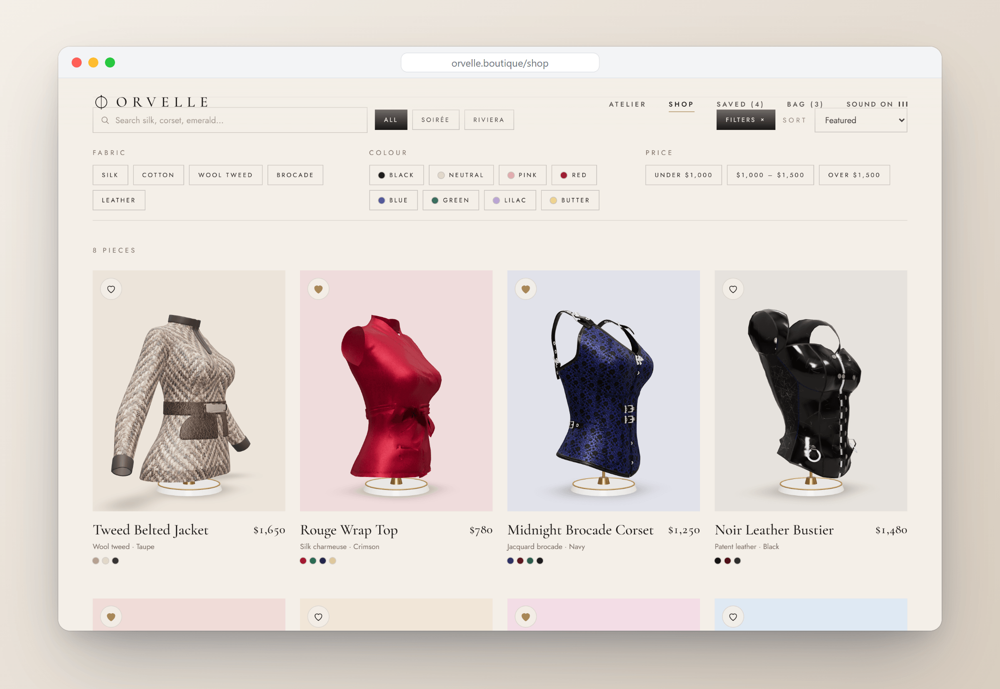</p>

### Product pages: colourways and fabric notes

The piece gets the whole page, with a floating purchase panel beside it. Gold dots sit on the garment itself; tapping one, or its chip below the piece, opens a fabric note and turns the piece to face it. Colourways re-dye the actual fabric texture, so weave, print and shine stay intact. A size guide opens a measurement chart, with the waist column highlighted for corsetry.

| | |
| --- | --- |
| 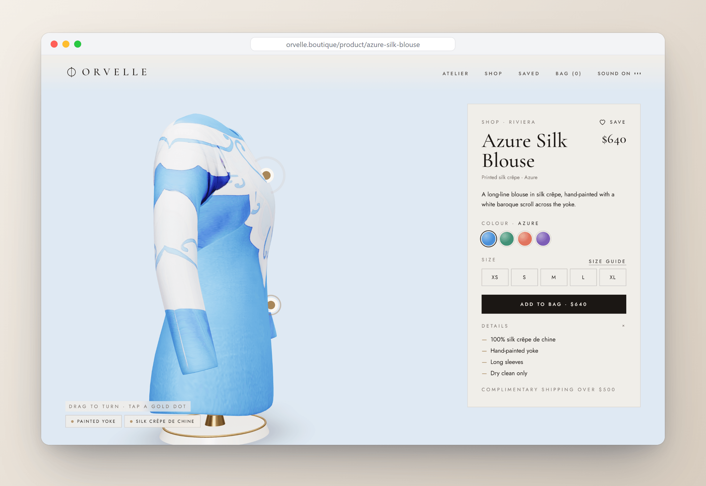 | 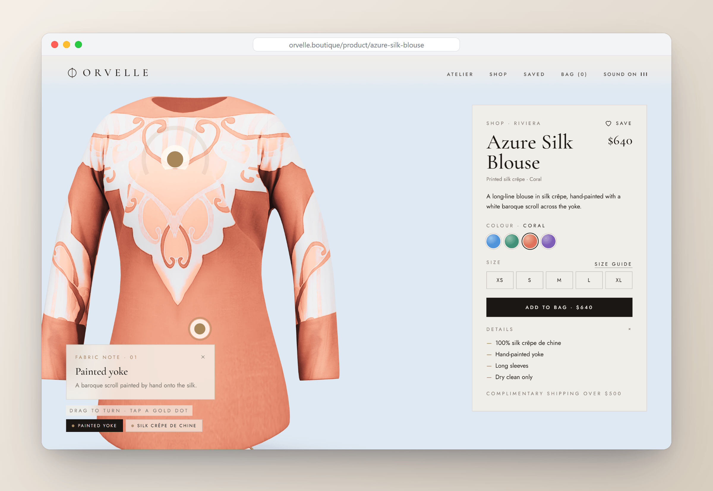 |

### Bag, saved pieces and a demo checkout

The bag slides in from the right over a blurred page, keeps one line per piece, size and colourway, and survives reloads. Saved pieces have their own page. The checkout has contact and shipping fields, an order summary with shipping and estimated tax, and a clear notice that it is a demo.

| | |
| --- | --- |
| 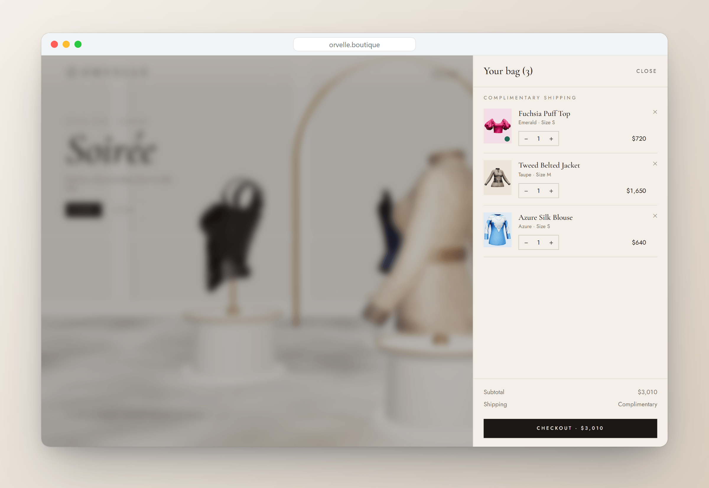 | 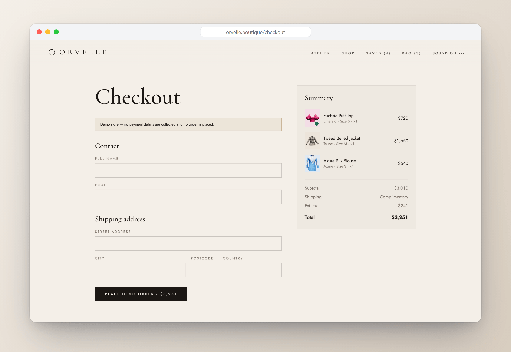 |

<p align="center">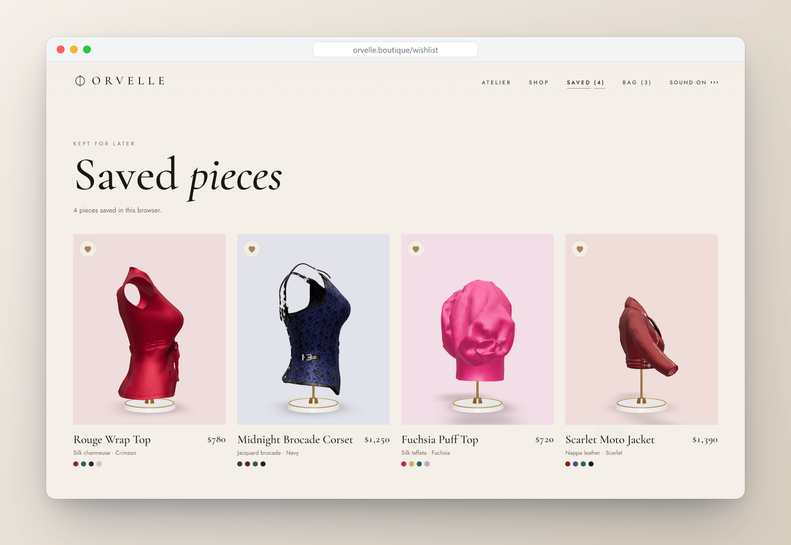</p>

<details>
<summary><b>Full feature list</b></summary>

**Atelier (home)**
- Two collections, Soirée and Riviera, each with a title, season and short note.
- A ring of four plinths that eases round to the chosen piece; the front piece turns on a slow turntable.
- Autoplay every 5.5 seconds, moving to the next collection after the last piece. It waits longer after a manual choice, pauses while a piece is hovered or the tab is hidden, and is off with reduced motion.
- Previous and next buttons, a progress dash that fills while a piece waits its turn, and swipe on touch screens.
- A custom cursor ring that reads "Select" or "View" over the pieces.
- A camera glide and an ivory veil when opening a piece.

**Shop**
- Accent-insensitive search across names, fabrics, colourways and details.
- Collection tabs, fabric, colour-family and price filters, and sorting by price.
- An empty state with a "clear filters" action.
- Saved-piece hearts and quick add to bag on each card.

**Product**
- A full 3D stage with drag to turn (PresentationControls).
- Gold hotspots on the garment and matching fabric-note chips for keyboard and touch.
- Colourways that re-dye the fabric in a shader, with metal hardware left untouched.
- Size selection with a nudge if you add without a size, a size guide modal and a details list.
- "Complete the look" with other pieces from the same collection.

**Everywhere**
- A bag drawer and saved pieces, both persisted in `localStorage`.
- A demo checkout with an order confirmation.
- An Info page with shipping, returns, privacy and 3D model credits.
- Quiet ambient sound that fades in on the first interaction, with a mute toggle that is remembered.
- Page transitions under an ivory veil, a loading skeleton while models load, and a custom 404.

</details>

## Design

- **A Parisian salon.** The atelier is built in Three.js rather than from images: a plaster wall with panel mouldings, pilasters, a dado rail and a gilded cornice, a brass arch, stone plinths with gold rings and a marble floor painted on a canvas at run time.
- **Ivory, ink and gold.** Five tokens carry the whole interface: ivory `#f4efe8`, stone `#e7e0d6`, ink `#1b1714`, muted `#7a6f64` and gold `#a8875a`. Each piece adds its own soft tint behind it in the shop and on its product page.
- **Editorial type.** Cormorant for display titles, often in italic, and Jost for body text, with small, widely tracked uppercase labels for navigation and eyebrows.
- **Studio lighting.** A shared room environment map (generated locally, no HDR download) and a warm key light make every garment read like a product photo, with contact shadows under each stand.
- **Quiet motion.** Damped easing on every camera and ring move, letter-by-letter title reveals, a cursor ring and page veils. Reduced motion stops the autoplay and the camera glide.
- **Mobile first where it counts.** On phones the camera pulls back so one piece fills the arch, the controls stack under it and swiping turns the ring. Product pages give the piece its own band above the purchase panel.
- **Light theme only.** The boutique is designed around one warm ivory palette; there is no dark mode.

<p align="center">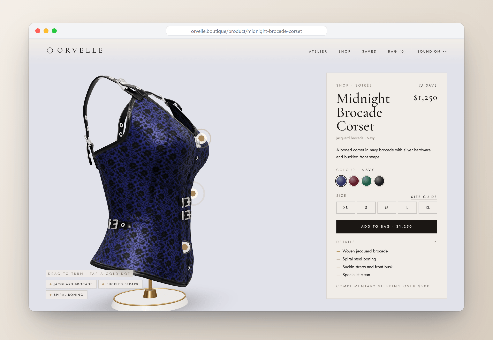</p>

<p align="center">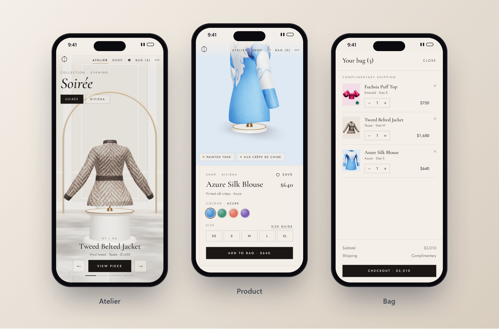</p>

## Screenshots

All screenshots come from the running app: desktop at 1440×900 and mobile at 390×844, both at retina resolution, captured once the 3D scenes had loaded and settled. The GIF is a 6-second recording of the atelier at 12 fps.

## Tech stack

| Layer | Technology | Why |
| --- | --- | --- |
| Framework | Next.js 15.5 (App Router, Turbopack), React 19.1 | File-based routes for the atelier, shop, product, saved, checkout and info pages |
| Language | TypeScript 5 | Typed products, colourways, hotspots and bag lines |
| 3D | Three.js 0.180, React Three Fiber 9, drei 10, maath | Declarative scenes, `View`s that share one canvas, and damped easing |
| Models | glTF with Draco compression, self-hosted decoder | Eight garments in about 3 MB, loaded without a third-party CDN |
| Motion | GSAP 3.13 with `@gsap/react`, CSS animations | GSAP drives the ambient sound control; reveals, veils and the autoplay dash are CSS |
| Styling | Tailwind CSS 4 with `@theme` tokens | One small palette and type scale shared by every page |
| State | React context and `localStorage` | Bag and saved pieces without a backend |
| Tooling | ESLint 9 (`eslint-config-next`) | One lint command for the whole project |

## Architecture

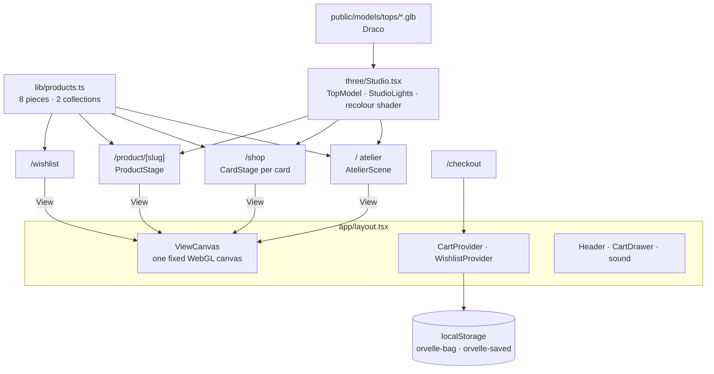

**One canvas, many views.** The root layout mounts a single fixed `<Canvas>`; each page places drei `<View>`s that render into it inside their own rectangles. Eight shop cards therefore share one WebGL context instead of opening eight, and a `ClearEachFrame` pass wipes the canvas before the views draw so nothing is left behind when you scroll.

## Engineering highlights

- **Colourways that keep the fabric.** `makeRecolorable` patches each garment material's fragment shader: it keeps every pixel's brightness, swaps its hue for the chosen colour and normalises by the cloth's average brightness (measured once from a 24×24 downsample), so a pale tweed and a dark brocade both dye to a true colour. With `protectNeutrals`, low-saturation pixels such as silver buckles and lace keep their original colour.
- **Per-instance materials.** `TopModel` clones each model's materials, so the same piece can be dyed on its product page while it keeps its own colour in the bag thumbnail and on the ring. Solid metal parts are detected and never dyed.
- **A ring that never fights itself.** The ring eases to `-(active / count) · 2π` with `easing.dampAngle`, so it always takes the short way round, while only the front piece turns on its own turntable and the others ease back to face forward.
- **Autoplay that respects the visitor.** The timer pauses on hover, while a piece is opening and while the tab is hidden, waits longer after a manual choice, and is skipped entirely with reduced motion.
- **Hotspots pinned to the cloth.** Fabric notes are stored as fractions of the piece's height; at load, `ProductStage` casts a ray at the front of the garment and keeps the first surface it hits, so each gold dot sits just proud of the fabric whatever the model's shape. Opening a note turns the piece with `dampAngle` until that dot faces the camera, and the camera moves in.
- **A marble floor with no image.** `marbleTexture()` paints cloudy ground, soft and sharp veins and tile joints on a canvas with a seeded random generator, so the floor is identical on every visit and costs no download.
- **Loading without a spinner on top of the scene.** A tiny external store counts suspended views (`SuspenseSignal` inside the canvas), and the page shows its skeleton until every model and texture is ready.

```ts
// components/three/Studio.tsx (inside makeRecolorable)
mat.onBeforeCompile = (shader) => {
  Object.assign(shader.uniforms, uniforms);
  shader.fragmentShader = shader.fragmentShader
    .replace(
      "#include <common>",
      "#include <common>\nuniform vec3 uTint;\nuniform float uAmount;\nuniform float uBase;\nuniform float uProtect;"
    )
    .replace(
      "#include <map_fragment>",
      `#include <map_fragment>
      {
        vec3 src = diffuseColor.rgb;
        float l = dot(src, vec3(0.2126, 0.7152, 0.0722));
        float hi = max(src.r, max(src.g, src.b));
        float sat = (hi - min(src.r, min(src.g, src.b))) / max(hi, 1e-4);
        // relative (HSV) saturation: dark navy cloth still counts as coloured, silver hardware does not
        float mask = mix(1.0, smoothstep(0.12, 0.3, sat), uProtect);
        vec3 dyed = uTint * clamp(l / uBase, 0.0, 2.2);
        diffuseColor.rgb = mix(src, dyed, uAmount * mask);
      }`
    );
};
mat.customProgramCacheKey = () => "orvelle-recolor";
```

```ts
// components/three/AtelierScene.tsx
useFrame((_, delta) => {
  if (ring.current) easing.dampAngle(ring.current.rotation, "y", -(active / count) * Math.PI * 2, 0.45, delta);
  if (!cam.current) return;
  if (leaving) {
    // Glide up to the front piece; the page fades out over the last part of the move.
    easing.damp3(cam.current.position, [shiftX, PIECE_Y + 0.06, RADIUS + (isMobile ? 2.3 : 1.5)], 0.32, delta);
    easing.damp3(look.current, [shiftX, PIECE_Y, RADIUS], 0.25, delta);
  } else {
    const z = isMobile ? 7.4 : 5.1;
    easing.damp3(cam.current.position, [0, 1.02, z], 0.6, delta);
    easing.damp3(look.current, [0, isMobile ? 1.05 : 0.86, 0], 0.3, delta);
  }
  cam.current.lookAt(look.current);
});
```

```tsx
// components/ViewCanvas.tsx
/** One fixed WebGL canvas for the whole site; pages mount <View>s that render into it. */
<Canvas
  style={{ position: "fixed", inset: 0, overflow: "hidden", pointerEvents: "none" }}
  eventSource={eventSource ?? undefined}
  eventPrefix="client"
  dpr={[1, 2]}
  gl={{ antialias: true, alpha: true, toneMapping: THREE.ACESFilmicToneMapping, toneMappingExposure: 1.05 }}
  aria-hidden="true"
>
  <ClearEachFrame />
  <AssetsPreload />
  <Suspense fallback={<SuspenseSignal />}>
    <View.Port />
  </Suspense>
</Canvas>
```

## Getting started

**Prerequisites**

- Node.js 20 or newer and npm.
- A browser with WebGL 2 (any current desktop or mobile browser).

**Install and run**

```bash
git clone <repository-url> maison-orvelle
cd maison-orvelle
npm install
npm run dev
```

Open http://localhost:3000. No environment variables, keys or database are needed.

<details>
<summary><b>Scripts</b></summary>

| Script | What it does |
| --- | --- |
| `npm run dev` | Start the dev server with Turbopack |
| `npm run build` | Production build with Turbopack |
| `npm start` | Serve the production build |
| `npm run lint` | Run ESLint |

</details>

<details>
<summary><b>Project structure</b></summary>

```text
app/
  page.tsx                 atelier: the turning ring, collections and autoplay
  shop/page.tsx            search, filters, sorting and the product grid
  product/[slug]/          product page (ProductView) with colourways and fabric notes
  wishlist/page.tsx        saved pieces
  checkout/page.tsx        demo checkout and order confirmation
  info/page.tsx            shipping, returns, privacy and 3D model credits
  layout.tsx · template.tsx · not-found.tsx · globals.css
components/
  three/AtelierScene.tsx   salon wall, arch, marble floor, plinths and the ring
  three/ProductStage.tsx   product stage with hotspots and drag to turn
  three/CardStage.tsx      small turntable for shop cards
  three/Studio.tsx         TopModel, studio lights and the recolour shader
  three/boutique.ts        procedural marble texture
  ViewCanvas.tsx           the single shared WebGL canvas
  Header · CartDrawer · ProductCard · SizeGuide · CursorRing · MusicStreamLine · ...
lib/
  products.ts              the catalogue: pieces, colourways, hotspots, credits
  cart.tsx · wishlist.tsx  bag and saved pieces, persisted in localStorage
  gltf.ts · loading.ts     Draco model loading and the loading signal
public/
  models/tops/             eight Draco-compressed glTF garments
  draco/ · audio/ · images/tops/ · fonts/
```

</details>

## Testing & quality

There is no automated test suite yet. The project type-checks cleanly with `tsc --noEmit` and passes `npm run lint` with no warnings. Every flow in this README (the ring, both collections, filters, colourways, fabric notes, bag, saved pieces and checkout) was exercised in a browser on desktop and phone sizes while preparing the screenshots.

## Deployment

The app is a standard Next.js project with no server-side dependencies, so it deploys to Vercel or any Node host with `npm run build` and `npm start`. Models, the Draco decoder, fonts and audio are all served from `public/`, so no external CDN needs to be reachable.

## Roadmap

- Add tests: unit tests for the bag, saved pieces and shop filters, and a Playwright smoke test that opens a piece from the ring.
- Connect a real catalogue and payment provider behind the existing `lib/products.ts` and checkout form.
- Offer a lighter fallback (posters in `public/images/tops`) for devices without WebGL.

## Credits

The garments are based on 3D models shared under [CC BY 4.0](https://creativecommons.org/licenses/by/4.0/). Each model's title and author are listed on the Info page and in `lib/products.ts`; the models were compressed for the web and renamed for this store.